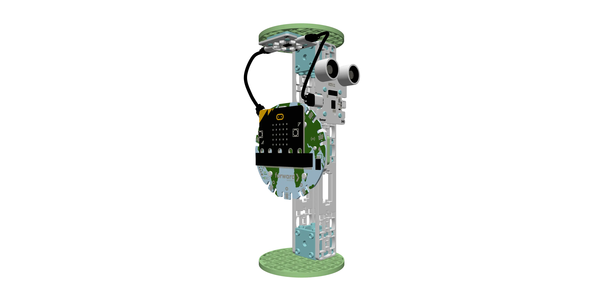
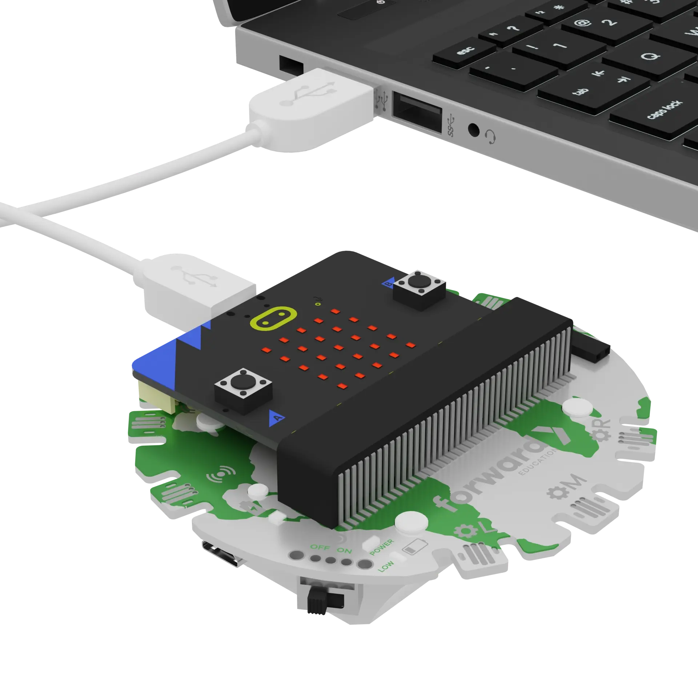
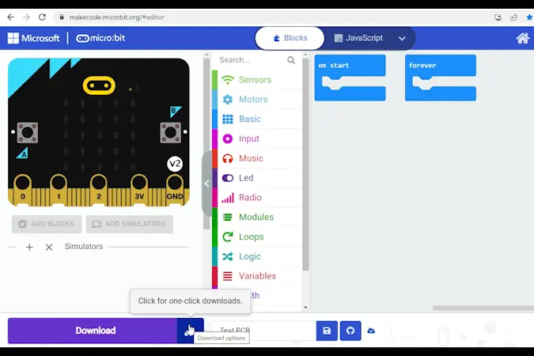

# Smart Streetlights

```package
fwd-climate-action=github:Forward-Education/pxt-climate-action#v2.1.1
```

```template
basic.forever(function () {
    basic.showNumber(input.temperature())
    basic.pause(100)
})
basic.forever(function () {
    if (fwdSensors.sonar1.isPastThreshold(0.2, fwdEnums.OverUnder.Under)) {
        fwdLights.ledRing1.setAllPixelsColor(0xffffff)
    } else {
        fwdLights.ledRing1.setAllPixelsColor(0x000000)
    }
    basic.pause(100)
})
```

## Welcome! @showdialog

Most streetlights stay on all night, even when no one is around. That wastes a lot of energy.

A **smart streetlight** only turns on when someone is nearby. Today you will code one!

Build your streetlight before you start.



## Three Parts @showdialog

This tutorial has three parts:

1. **Use:** Your code is ready. Get your streetlight working.
2. **Modify:** Change the code to make it your own.
3. **Create:** Design a streetlight for a special event.

You can stop after any part. Your work is saved.

## Get Ready @showdialog

Turn on your Breakout Board. Plug your micro:bit into your computer.



## Pair Your micro:bit @showdialog

Click the three dots beside the `|Download|` button. Click **Connect Device**. Follow the steps to pair your micro:bit.



## Download

Click `|Download|` to send the code to your micro:bit.

## Part 1: Use @showdialog

Your streetlight code is ready. Let's see what it does!

Click **Tell me more!** if you need help.

## Use Step 1

Look at your streetlight. Can you name all its parts?

~hint Tell me more!
- The **micro:bit** is the brain. It runs the code that tells the streetlight what to do.
- The **sonar sensor** can tell when something is nearby, like a person or a car.
- The **LED ring** is the light.
hint~

## Use Step 2

Why do you think our streetlight has a [**sonar sensor**](https://learn.forwardedu.com/sonar-sensor/)?

~hint Tell me more!
- A sonar sensor works like a bat! It sends out sound and listens for the echo. That tells it how far away things are.
- We want the light to turn on when people or cars come close.
hint~

## Use Step 3

Read the code in your workspace from top to bottom.

What do you think will happen when you move your hand close to the sonar sensor?

## Use Step 4

Let's test it!

1. Move your hand slowly toward the sonar sensor. What happens?
2. Move your hand away. What happens?
3. Hold your hand in front of the sensor for a few seconds. What happens?

Was your prediction right?

## Use Step 5

The streetlight uses a **conditional statement** to decide **when** to turn on. Can you find it in the code?

~hint Tell me more!
- **If** something is closer than 0.2 m (20 cm), the LED ring turns on.
- **Else** (if nothing is close), the LED ring turns off.
hint~

```blocks
basic.forever(function () {
    // @highlight
    if (fwdSensors.sonar1.isPastThreshold(0.2, fwdEnums.OverUnder.Under)) {
        fwdLights.ledRing1.setAllPixelsColor(0xffffff)
    } else {
        fwdLights.ledRing1.setAllPixelsColor(0x000000)
    }
    basic.pause(100)
})
```

## Use Step 6

Look at the micro:bit screen. It shows the **temperature** in °C.

Smart streetlights in real cities can share information too, like the weather, traffic warnings, or community events.

```blocks
basic.forever(function () {
    // @highlight
    basic.showNumber(input.temperature())
    basic.pause(100)
})
```

## Checkpoint: You Did It! @showdialog

Your smart streetlight works!

**Think:** How does a smart streetlight help save energy?

You can stop here. Or click **Next** to go on to **Part 2: Modify**.

## Part 2: Modify @showdialog

Now you will change the code to make the streetlight your own.

After each change, click `|Download|` and test your streetlight.

## Modify Step 1

Right now, the light only turns on when something is closer than **0.2 m** (20 cm).

How could you make it notice things that are **farther** away?

~hint Tell me more!
- Change **0.2** in ``||fwdSensors:sonar1 is under 0.2 m||`` to a bigger number, like **0.5** or **1**.
- Don't forget to download your new code!
hint~

```blocks
basic.forever(function () {
    // @highlight
    if (fwdSensors.sonar1.isPastThreshold(1, fwdEnums.OverUnder.Under)) {
        fwdLights.ledRing1.setAllPixelsColor(0xffffff)
    } else {
        fwdLights.ledRing1.setAllPixelsColor(0x000000)
    }
    basic.pause(100)
})
```

## Modify Step 2

Streetlights don't have to be bright white. Some cities use warmer colours to reduce **light pollution**.

Click the white circle in the first ``||fwdLights:set all ledRing1 pixels to||`` block. Pick a new colour.

~hint Tell me more!
- Leave the second block black. That's what turns the light off.
hint~

```blocks
basic.forever(function () {
    if (fwdSensors.sonar1.isPastThreshold(1, fwdEnums.OverUnder.Under)) {
        // @highlight
        fwdLights.ledRing1.setAllPixelsColor(0xffff00)
    } else {
        fwdLights.ledRing1.setAllPixelsColor(0x000000)
    }
    basic.pause(100)
})
```

## Modify Step 3

What if your streetlight showed a message or a picture instead of the temperature?

Replace ``||basic:show number||`` with ``||basic:show string||`` or ``||basic:show icon||``.

~hint Tell me more!
- Only change the block that shows the temperature. Keep your light code as it is!
- The example shows a message. You could show an icon instead.
hint~

```blocks
basic.forever(function () {
    // @highlight
    basic.showString("Traffic ahead!")
    basic.pause(100)
})
```

## Checkpoint: Great Work! @showdialog

You made your streetlight your own!

**Think:** What information would be most helpful for a streetlight to share in your neighbourhood?

You can stop here. Or click **Next** to go on to **Part 3: Create**.

## Part 3: Create @showdialog

Streetlights aren't just for safety. They can bring art and celebration to a city, too!

**Challenge:** Design your streetlight to celebrate a holiday or event that's important to you.

There are no steps this time. Try your ideas, test them, and change them. Click the lightbulb if you need ideas.

## Create

Design your themed streetlight. Download and test it.

~hint Need ideas?
- Choose a colour and a message or icon that match your theme.
- Right-click your new blocks and choose **Add Comment**. Explain how they connect to your theme.
- Decorate the light post with construction paper and other craft supplies.
hint~

## Reflection @showdialog

Think about your project:

- What was one tricky part? How did you figure it out?
- What is one more way you could improve your streetlight?

## Finished! @showdialog

Great work! Click `|Done|` to finish the tutorial.
