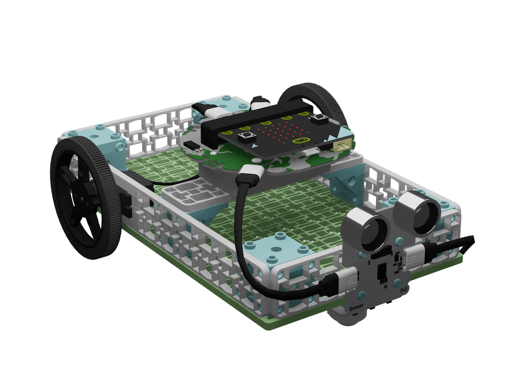
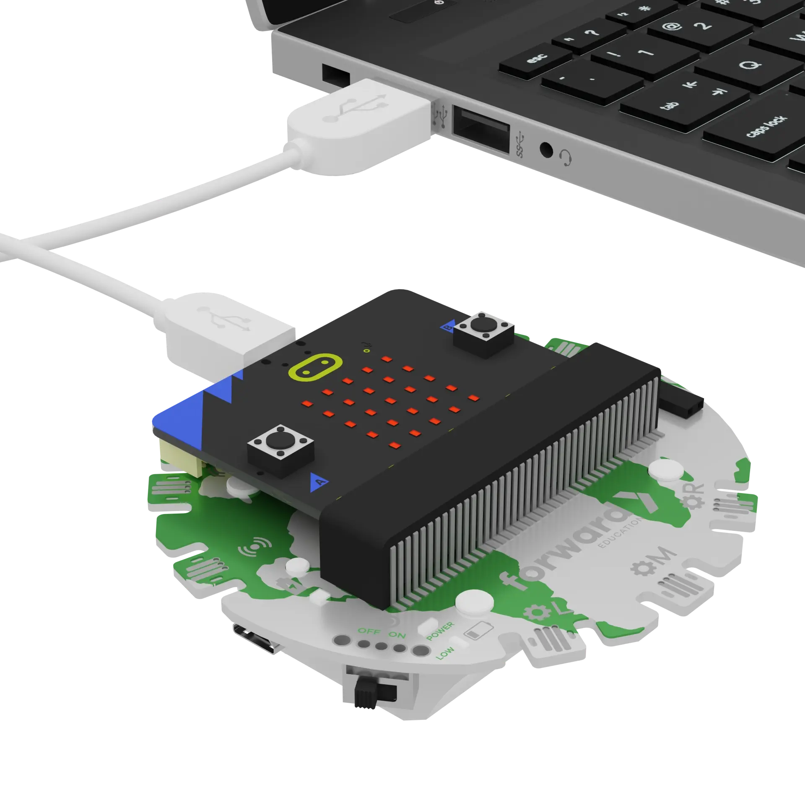
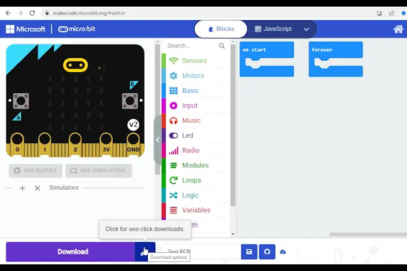

# Autonomous Electric Vehicles of the Future

```package
fwd-climate-action=github:Forward-Education/pxt-climate-action#v2.1.1
```

```template
input.onButtonPressed(Button.A, function () {
    IsDrivingEnabled = true
})
input.onButtonPressed(Button.B, function () {
    IsDrivingEnabled = false
})
let IsDrivingEnabled = false
fwdMotors.setupDriving(fwdBase.leftServo, fwdBase.rightServo)
basic.forever(function () {
    if (IsDrivingEnabled) {
        if (fwdSensors.sonar1.isPastThreshold(0.5, fwdEnums.OverUnder.Under)) {
            fwdMotors.driveTimed(50, 50, 500)
        } else {
            fwdMotors.drive(50, -50)
        }
    } else {
        fwdMotors.stop()
    }
})
```

## Welcome! @showdialog

Electric vehicles are replacing gas-powered cars, and many can now steer around obstacles on their own. They use sensors to see the road and a computer to decide what to do.

Today you will code an **autonomous electric vehicle** that drives itself and avoids obstacles.

Build your electric vehicle before you start.



## Three Parts @showdialog

This tutorial has three parts:

1. **Use:** Your code is ready. Get your vehicle driving.
2. **Modify:** Tune and improve how your vehicle avoids obstacles.
3. **Create:** Invent something new on your own.

You can stop after any part. Your work is saved.

## Get Ready @showdialog

Turn on your Breakout Board. Plug your micro:bit into your computer.



## Pair Your micro:bit @showdialog

Click the three dots beside the `|Download|` button. Click **Connect Device**. Follow the steps to pair your micro:bit.



## Download

Click `|Download|` to send the starter code to your micro:bit.

## Part 1: Use @showdialog

Your vehicle's code is already in the workspace. Let's find out how it works.

1. Follow the instructions at the top of the screen.
2. Click **Tell me more!** for more information.
3. Click the lightbulb for help with the code.

## Use Step 1

Look at your vehicle. Which part works like a car's **Electronic Control Unit (ECU)**, the "brain" that makes decisions?

~hint Tell me more!
- The **micro:bit** is the brain. It runs the code and makes decisions, like the ECU in a real vehicle.
hint~

## Use Step 2

Which part works like an electric vehicle's **battery**? Which part works like its **ultrasonic sensors**?

~hint Tell me more!
- The **Breakout Board** has a built-in battery. It powers the whole project, like a vehicle's battery powers everything from the motors to the lights.
- The **sonar sensor** works like the ultrasonic sensors in real vehicles. It detects obstacles so the vehicle can avoid collisions.
hint~

## Use Step 3

Look at the code. Why do you think we use the variable ``||variables:IsDrivingEnabled||``? What might happen without it?

~hint Tell me more!
- ``||variables:IsDrivingEnabled||`` works like an on/off switch for driving.
- Without it, the vehicle would start moving as soon as the Breakout Board turned on, and keep going until it was turned off.
hint~

## Use Step 4

What do you think will happen when you press **A**? What about **B**?

~hint Tell me more!
- **A** turns driving on, like pressing the accelerator.
- **B** turns driving off, like pressing the brake.
- That's exactly why we created ``||variables:IsDrivingEnabled||``: to control when the vehicle moves.
hint~

```blocks
input.onButtonPressed(Button.A, function () {
    IsDrivingEnabled = true
})
input.onButtonPressed(Button.B, function () {
    IsDrivingEnabled = false
})
```

## Use Step 5

Look at the code in ``||basic:forever||``. What do you think it will do?

Make a guess. Then unplug your vehicle, put it on the floor, and press **A**. Press **B** to stop.

```blocks
basic.forever(function () {
    if (IsDrivingEnabled) {
        if (fwdSensors.sonar1.isPastThreshold(0.5, fwdEnums.OverUnder.Under)) {
            fwdMotors.driveTimed(50, 50, 500)
        } else {
            fwdMotors.drive(50, -50)
        }
    } else {
        fwdMotors.stop()
    }
})
```

## Use Step 6

Find ``||fwdSensors:sonar1 is under 0.5 m||`` in the code. What does it mean for your vehicle?

~hint Tell me more!
- The sonar sensor checks for anything **closer than 0.5 m** (50 cm).
- It's a **boolean expression**: it's either true or false.
- If it's true, the code under **if** runs. If it's false, the code under **else** runs.
hint~

```blocks
basic.forever(function () {
    // @highlight
    if (fwdSensors.sonar1.isPastThreshold(0.5, fwdEnums.OverUnder.Under)) {
        fwdMotors.driveTimed(50, 50, 500)
    } else {
        fwdMotors.drive(50, -50)
    }
})
```

## Use Step 7

What does the vehicle do when something is in its path? What does it do when the path is clear?

~hint Tell me more!
- **Path clear:** ``||fwdMotors:set left to 50 % and right to -50 %||`` drives forward and keeps going, while the sonar keeps checking.
- **Obstacle:** ``||fwdMotors:set left to 50 % and right to 50 % for 500 ms||`` spins right for half a second, then the loop checks again.
- The left and right motors face opposite ways. That's why "forward" uses a positive and a negative number.
hint~

## Use Step 8

Let's test it! Set up some obstacles, like books, boxes, or a wall. Run your vehicle toward them a few times.

Come back here when you're done.

## Use Step 9

Welcome back!

- What obstacles did you use?
- How well did your vehicle avoid them?
- When did it get stuck or bump into something?
- How could you improve it?

## Checkpoint: You Did It! @showdialog

Your autonomous vehicle drives on its own!

**Think:** What would a real autonomous vehicle need to handle that yours can't yet?

You can stop here. Or click **Next** to go on to **Part 2: Modify**.

## Part 2: Modify @showdialog

Now you will tune and improve how your vehicle avoids obstacles.

After each change:

1. Plug in your micro:bit and click `|Download|`.
2. Unplug it and test your vehicle on the floor.

## Modify Step 1

What happens if the vehicle waits until it's **closer** to an obstacle before turning?

Change **0.5** in ``||fwdSensors:sonar1 is under 0.5 m||`` to **0.2**. Download and test.

~hint Tell me more!
- The vehicle now gets closer before it turns.
- A smaller distance means fewer false alarms from things that aren't really in the way.
hint~

```blocks
basic.forever(function () {
    // @highlight
    if (fwdSensors.sonar1.isPastThreshold(0.2, fwdEnums.OverUnder.Under)) {
        fwdMotors.driveTimed(50, 50, 500)
    } else {
        fwdMotors.drive(50, -50)
    }
})
```

## Modify Step 2

Try other distances, like **0.1**, **0.3**, and **0.7** m. Predict what will happen each time, then test.

How could the **shape** of an obstacle change what the sonar detects?

~hint Tell me more!
- Test in the same spot each time, so your results are fair.
- Sound bounces back best from flat, hard surfaces. Soft or angled objects can be harder to detect.
hint~

## Modify Step 3

Which distance worked best? Set ``||fwdSensors:sonar1 is under||`` to that value.

## Modify Step 4

Real vehicles are **calibrated**: engineers test and adjust them until they behave just right.

Let's calibrate the turn. Change **500** in ``||fwdMotors:set left to 50 % and right to 50 % for 500 ms||``. Test until your vehicle turns about a **quarter turn** (90°).

~hint Tell me more!
- A bigger number means a longer, bigger turn.
- Mark the floor with tape to measure the turn.
- Every vehicle is a little different. Your number may not match a classmate's.
hint~

```blocks
basic.forever(function () {
    if (fwdSensors.sonar1.isPastThreshold(0.2, fwdEnums.OverUnder.Under)) {
        // @highlight
        fwdMotors.driveTimed(50, 50, 700)
    } else {
        fwdMotors.drive(50, -50)
    }
})
```

## Modify Step 5

Does your vehicle drive in a **straight line**? Or does it curve?

If it curves, adjust one of the speeds in ``||fwdMotors:set left to 50 % and right to -50 %||`` until it drives straight.

~hint Tell me more!
- Two motors are never exactly the same, so one side can be a little faster.
- If it curves **right**, the left motor is faster. Try a smaller left speed, like **45**.
- If it curves **left**, the right motor is faster. Try a right speed closer to zero, like **-45**.
hint~

```blocks
basic.forever(function () {
    if (fwdSensors.sonar1.isPastThreshold(0.2, fwdEnums.OverUnder.Under)) {
        fwdMotors.driveTimed(50, 50, 700)
    } else {
        // @highlight
        fwdMotors.drive(50, -45)
    }
})
```

## Challenge Time! @showdialog

With a shorter sonar distance, your vehicle can end up in tight spots. Just turning isn't always enough.

Let's teach it a safer routine for obstacles: **stop**, **pause**, **back up**, then **turn**.

## Challenge Step 1

First, the vehicle should stop right away when it sees an obstacle.

Open ``||fwdMotors:Motors||``. Drag ``||fwdMotors:stop driving||`` to the **top** of the **if** section, above the turn block.

~hint Tell me more!
- This works like the emergency braking in real vehicles.
- Stopping first gives the obstacle a chance to clear.
hint~

```blocks
basic.forever(function () {
    if (fwdSensors.sonar1.isPastThreshold(0.2, fwdEnums.OverUnder.Under)) {
        // @highlight
        fwdMotors.stop()
        fwdMotors.driveTimed(50, 50, 700)
    } else {
        fwdMotors.drive(50, -45)
    }
})
```

## Challenge Step 2

Now add a short wait. Open ``||basic:Basic||``. Drag ``||basic:pause (ms)||`` under ``||fwdMotors:stop driving||``. Set it to **1000** ms (1 second).

~hint Tell me more!
- The pause gives the vehicle a moment to "decide", like a driver at an intersection.
- It also makes the vehicle's moves easier to see and adjust while testing.
hint~

```blocks
basic.forever(function () {
    if (fwdSensors.sonar1.isPastThreshold(0.2, fwdEnums.OverUnder.Under)) {
        fwdMotors.stop()
        // @highlight
        basic.pause(1000)
        fwdMotors.driveTimed(50, 50, 700)
    } else {
        fwdMotors.drive(50, -45)
    }
})
```

## Challenge Step 3

Now help the vehicle back away from the obstacle.

Drag a ``||fwdMotors:set left to 50 % and right to -50 % for 1000 ms||`` block under the pause. Change the speeds so it drives **backward**.

~hint Tell me more!
- Backward is the opposite of forward. Flip both signs: left **-50**, right **50**.
- Backing up first gives the vehicle room to turn.
hint~

```blocks
basic.forever(function () {
    if (fwdSensors.sonar1.isPastThreshold(0.2, fwdEnums.OverUnder.Under)) {
        fwdMotors.stop()
        basic.pause(1000)
        // @highlight
        fwdMotors.driveTimed(-50, 50, 1000)
        fwdMotors.driveTimed(50, 50, 700)
    } else {
        fwdMotors.drive(50, -45)
    }
})
```

## Challenge Step 4

Test your vehicle in a tight spot, like a corner or a narrow gap.

Is it better at getting out than before? What would you change next?

## Checkpoint: Great Work! @showdialog

Your vehicle now has a full obstacle-avoidance routine!

**Think:** Why do real autonomous vehicles need to be tested in so many different conditions?

You can stop here. Or click **Next** to go on to **Part 3: Create**.

## Part 3: Create @showdialog

Now it's your turn to invent!

**Challenge:** How could your vehicle drive more safely, more efficiently, or more like a real autonomous vehicle? Add your own idea to the code.

There are no steps this time. Test your ideas, change them, and test again. Click the lightbulb if you need ideas.

## Create

Add your own idea to your vehicle. Download and test it.

~hint Need ideas?
- **Slow down near obstacles:** use ``||fwdSensors:sonar1 distance (m)||`` to drive slower as things get closer, and save battery.
- Turn left or right at random, so the vehicle doesn't get stuck in the same pattern.
- Show an arrow or icon on the micro:bit so people nearby know what the vehicle will do next.
- Count how many obstacles the vehicle avoids and show the total when you press **B**.
hint~

## Reflection @showdialog

Think about your project:

- What was one challenge? How did you solve it?
- What is one thing you want to learn more about?

## Finished! @showdialog

Great work! Click `|Done|` to finish the tutorial.
