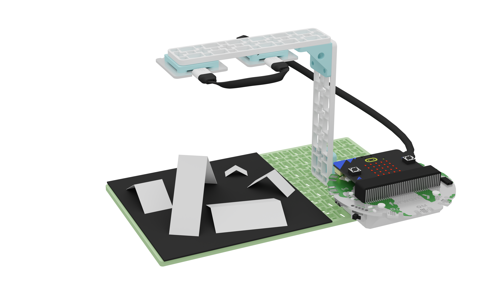
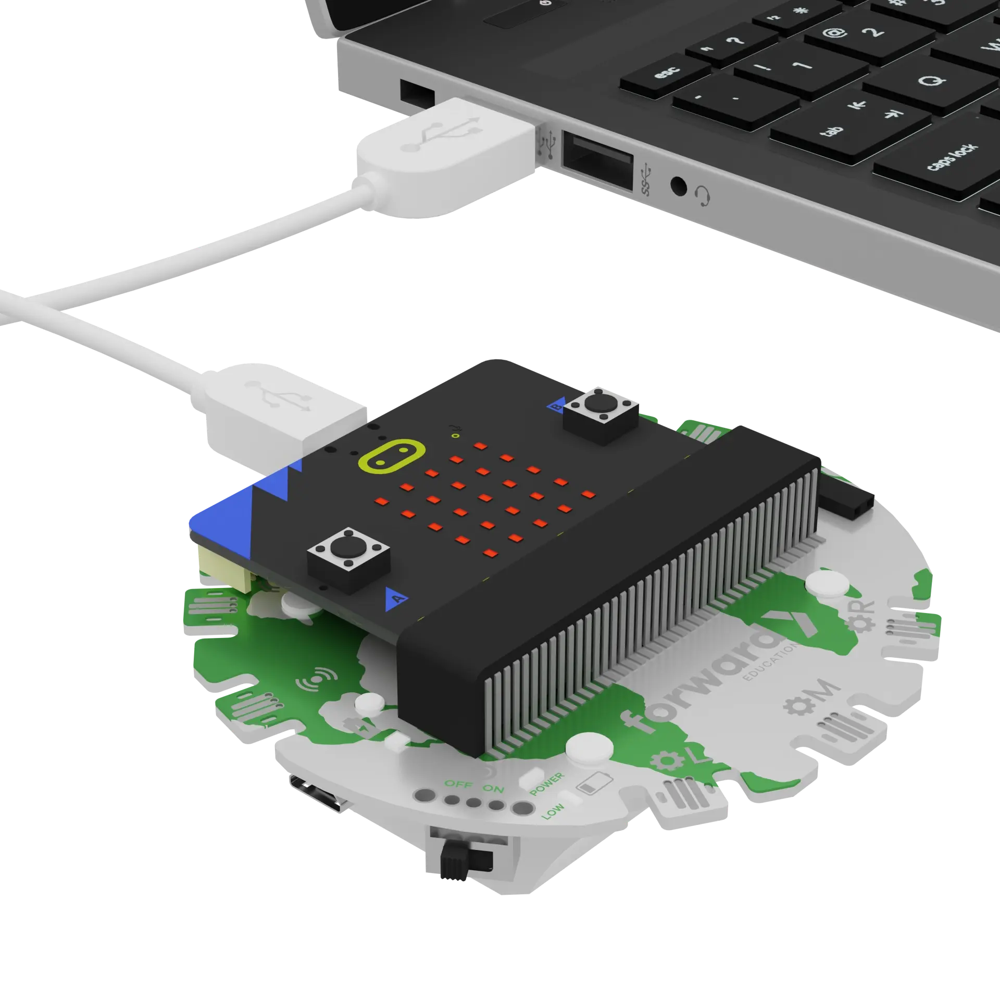
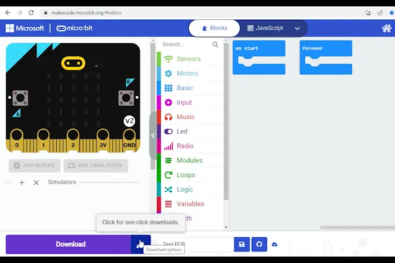
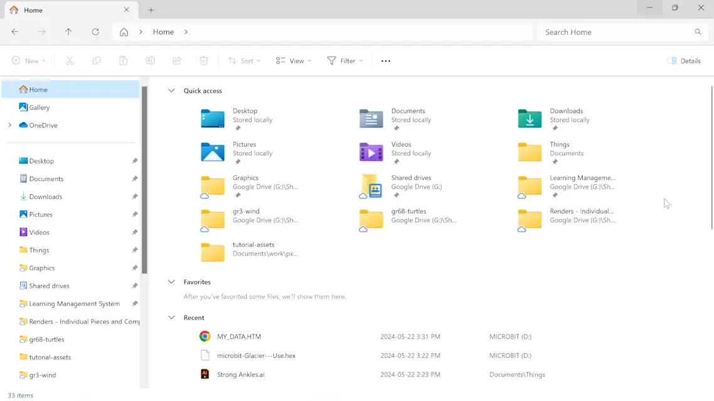

# Glacier Tracking with Satellites

```package
fwd-climate-action=github:Forward-Education/pxt-climate-action#v2.1.1
datalogger=datalogger
```

```template
datalogger.mirrorToSerial(true)
datalogger.setColumnTitles("Light Level (%)")
fwdLights.ledRing1.setBrightness(10)
fwdLights.ledRing1.setAllPixelsColor(0xffffff)
basic.forever(function () {
    datalogger.log(datalogger.createCV("Light Level (%)", fwdSensors.solar1.lightLevel()))
    basic.pause(500)
})
```

## Welcome! @showdialog

Satellites help scientists track glaciers from space. They measure how much sunlight Earth's surface reflects. This is called **albedo**.

White snow and ice reflect a lot of sunlight. Dark oceans and land absorb it. As glaciers melt, Earth reflects less sunlight and warms even more.

Today you will use a model **glacier satellite** to measure albedo.

Build your satellite before you start. You will also need white, black, and yellow paper, plus a few small rectangles of white paper folded in half.



## Three Parts @showdialog

This tutorial has three parts:

1. **Use:** Your code is ready. Collect live data with your satellite.
2. **Modify:** Change the code to control when data is collected, then run an experiment.
3. **Create:** Invent something new on your own.

You can stop after any part. Your work is saved.

## Get Ready @showdialog

Turn on your Breakout Board. Plug your micro:bit into your computer.



## Pair Your micro:bit @showdialog

Click the three dots beside the `|Download|` button. Click **Connect Device**. Follow the steps to pair your micro:bit.



## Download

Click `|Download|` to send the starter code to your micro:bit.

## Part 1: Use @showdialog

Your satellite's code is already in the workspace. Let's find out how it works.

1. Follow the instructions at the top of the screen.
2. Click **Tell me more!** for more information.
3. Click the lightbulb for help with the code.

## Use Step 1

Look at your project. Which part represents the **sun**?

~hint Tell me more!
- The **LED ring** represents the sun. The code turns it on bright white.
hint~

```blocks
fwdLights.ledRing1.setBrightness(10)
fwdLights.ledRing1.setAllPixelsColor(0xffffff)
```

## Use Step 2

Which part represents **Earth's surface**? Which part is the **satellite**?

~hint Tell me more!
- The **baseplate** represents Earth's surface.
- The **solar sensor** is the satellite. It measures how much light bounces back up from the surface.
- ``||datalogger:log data||`` records each reading, twice a second.
hint~

```blocks
basic.forever(function () {
    datalogger.log(datalogger.createCV("Light Level (%)", fwdSensors.solar1.lightLevel()))
    basic.pause(500)
})
```

## Use Step 3

Let's look at the data from your satellite.

Below the micro:bit simulator, click **Show data Device**. This opens a live graph of the readings from your real project.

~hint Tell me more!
- If the button says **Show data Simulator**, your micro:bit isn't paired. The simulator only shows pretend data. Go back and pair your micro:bit, then download again.
- Can't see the button? Zoom out: press **Ctrl** and **-** (Windows or Chromebook) or **Command** and **-** (Mac).
hint~

## Use Step 4

Watch the graph. Hold your hand over the baseplate, then move it away. What happens to the line?

~hint Tell me more!
- The graph shows how much light reflects back to the solar sensor over time.
- The numbers are percentages. **100** means all the light the sensor can detect. **0** means none.
hint~

## Use Step 5

Let's experiment! First, predict how the light level will change when you put each paper on the baseplate:

- **white** paper (snow and ice)
- **black** paper (dark ocean or land)
- **yellow** paper (partly melted snow)

## Use Step 6

Put the **white** paper on the baseplate. Watch the graph. Was your prediction right?

~hint Tell me more!
- White reflects almost all visible light, so the light level should go **up**.
hint~

## Use Step 7

Now put the **black** paper on the baseplate. What happens?

~hint Tell me more!
- Black absorbs almost all visible light, so the light level should go **down**.
hint~

## Use Step 8

Try the **yellow** paper. What do you notice?

~hint Tell me more!
- Yellow reflects **some** light.
- The light level should go up, but not as high as with white paper.
hint~

## Use Step 9

Try other colours and materials, like aluminum foil or a paper towel. Can you explain what you see?

## Checkpoint: You Did It! @showdialog

Your satellite is collecting real albedo data!

**Think:** Why would scientists use satellites, instead of visiting every glacier?

You can stop here. Or click **Next** to go on to **Part 2: Modify**.

## Part 2: Modify @showdialog

Right now, your satellite logs data **all the time**, even when you aren't running a test. Let's make it collect data only when you want it to.

After each change, click `|Download|` to send your code to the micro:bit.

## Modify Step 1

Let's collect data only while button **A** is held down.

1. Open ``||logic:Logic||``. Drag an ``||logic:if then||`` block into ``||basic:forever||``.
2. Open ``||input:Input||``. Drag ``||input:button A is pressed||`` into the **if** slot.
3. Move ``||datalogger:log data||`` and ``||basic:pause||`` inside the **if** block.

~hint Tell me more!
- This is a **conditional statement**. The code inside only runs when the condition is true.
- Pressing a button is a kind of **input**.
hint~

```blocks
basic.forever(function () {
    // @highlight
    if (input.buttonIsPressed(Button.A)) {
        datalogger.log(datalogger.createCV("Light Level (%)", fwdSensors.solar1.lightLevel()))
        basic.pause(500)
    }
})
```

## Modify Step 2

Let's test it. Download your code, then unplug your micro:bit.

Hold **A** for 10 seconds, then let go. The readings are saved on your micro:bit.

## Modify Step 3 @showdialog

Let's look at the data you saved.

1. Plug your micro:bit back into your computer.
2. Open the **MICROBIT** drive. Use **Finder** on a Mac, **File Explorer** on Windows, or **Files** on a Chromebook.
3. Open the file called **MY_DATA**.
4. Click **Visual preview** to see a graph. The Y-axis is light level and the X-axis is time in seconds.

Come back here when you're done.



**Need more help?** See this [micro:bit guide to data logging](https://microbit.org/get-started/user-guide/data-logging/#reading-data).

## Challenge Time! @showdialog

Let's make the satellite easier to use. We will:

1. Show an icon so you know when data is being collected.
2. Add a way to delete old data.

## Challenge Step 1

Right now, you have to trust that data is being saved. Let's show a sign on the micro:bit.

Open ``||basic:Basic||``. Drag ``||basic:show icon||`` inside the **if** block, above ``||datalogger:log data||``.

~hint Tell me more!
- Choose any icon you like. The example uses a check mark.
- Download and test your code!
hint~

```blocks
basic.forever(function () {
    if (input.buttonIsPressed(Button.A)) {
        // @highlight
        basic.showIcon(IconNames.Yes)
        datalogger.log(datalogger.createCV("Light Level (%)", fwdSensors.solar1.lightLevel()))
        basic.pause(500)
    }
})
```

## Challenge Step 2

Did you notice the icon stays on, even after you let go of **A**? The micro:bit doesn't know what to show when **A** isn't pressed.

Click the **+** at the bottom of the **if** block to add an **else**. Put another ``||basic:show icon||`` inside it.

~hint Tell me more!
- **If** A is pressed, show a check mark and collect data. **Else**, show an X.
hint~

```blocks
basic.forever(function () {
    if (input.buttonIsPressed(Button.A)) {
        basic.showIcon(IconNames.Yes)
        datalogger.log(datalogger.createCV("Light Level (%)", fwdSensors.solar1.lightLevel()))
        basic.pause(500)
    } else {
        // @highlight
        basic.showIcon(IconNames.No)
    }
})
```

## Challenge Step 3

Your log is full of test data you don't need. Let's make button **B** delete it.

1. Drag another ``||logic:if then||`` block into ``||basic:forever||``, below the first one.
2. Put ``||input:button B is pressed||`` in its slot. You'll find it in ``||input:Input||``. Change **A** to **B**.
3. Open ``||datalogger:Data Logger||``. Put ``||datalogger:delete log||`` inside the new **if** block.

~hint Tell me more!
- ``||datalogger:delete log||`` clears all saved data.
- Download your code. Then unplug, record some data with **A**, and clear it with **B**.
hint~

```blocks
basic.forever(function () {
    if (input.buttonIsPressed(Button.A)) {
        basic.showIcon(IconNames.Yes)
        datalogger.log(datalogger.createCV("Light Level (%)", fwdSensors.solar1.lightLevel()))
        basic.pause(500)
    } else {
        basic.showIcon(IconNames.No)
    }
    // @highlight
    if (input.buttonIsPressed(Button.B)) {
        datalogger.deleteLog()
    }
})
```

## Challenge Step 4 @showdialog

Did it work? Plug your micro:bit back in and open **MY_DATA** again. The log should be empty.


## Experiment @showdialog

Now you're ready for a real albedo experiment! You will measure the light reflected back to the satellite in seven situations:

1. Baseplate alone
2. White paper (a snowy glacier)
3. Black paper with **four** white rectangles (melting glaciers)
4. Black paper with **three** white rectangles
5. Black paper with **two** white rectangles
6. Black paper with **one** white rectangle
7. Black paper alone (ocean or land with no glacier)

**Predict:** How will the light level change from one situation to the next?

Press **B** to clear your log before you start.

## Experiment Step 1

Unplug your project. Make sure the baseplate is empty.

Hold **A** for 10 seconds, then let go.

~hint Tell me more!
- This is your **control**: what "normal" looks like before you change anything.
hint~

## Experiment Step 2

Cover the baseplate with **white** paper. Hold **A** for 10 seconds, then let go.

~hint Tell me more!
- White paper represents a healthy, snowy glacier. It has **high albedo**, so it reflects a lot of sunlight.
hint~

## Experiment Step 3

Put the **black** paper on the baseplate. Scatter the four white rectangles on top. Hold **A** for 10 seconds.

~hint Tell me more!
- Black paper represents dark ocean or land. It has **low albedo** and absorbs a lot of sunlight.
- The white rectangles are glaciers starting to melt.
hint~

## Experiment Step 4

Remove one rectangle at a time. After each one, hold **A** for 10 seconds.

~hint Tell me more!
- This models glaciers melting over time.
- What happens to the reflected light each time a glacier disappears?
hint~

## Experiment Step 5

When all the rectangles are gone, hold **A** for 10 seconds one last time, with just the black paper.

## Experiment Step 6 @showdialog

Let's compare your data with your predictions.

1. Plug your micro:bit back into your computer.
2. Open the **MICROBIT** drive, then **MY_DATA**.
3. Click **Visual preview** to see your results as a graph.

Do you see the light level step down as the glaciers melt?


## Checkpoint: Great Work! @showdialog

You ran a real albedo experiment!

**Think:** How did your data compare to your predictions? Can you explain any differences?

You can stop here. Or click **Next** to go on to **Part 3: Create**.

## Part 3: Create @showdialog

Now it's your turn to invent!

**Challenge:** How could your satellite tell scientists even more about melting glaciers? Add your own idea to the code.

There are no steps this time. Test your ideas, change them, and test again. Click the lightbulb if you need ideas.

## Create

Add your own idea to your satellite. Download and test it.

~hint Need ideas?
- Show the light level on the micro:bit screen while you hold **A**.
- Make a "melting alert": play a sound or show a warning icon when the light level drops below a number you choose.
- Log a second column, like the micro:bit's ``||input:temperature (°C)||``, to compare surfaces.
- Test new "surfaces", like sand, soil, or cotton balls, and compare their albedo.
hint~

## Reflection @showdialog

Think about your project:

- What was one challenge? How did you solve it?
- What is one thing you want to learn more about?

## Finished! @showdialog

Great work! Click `|Done|` to finish the tutorial.
