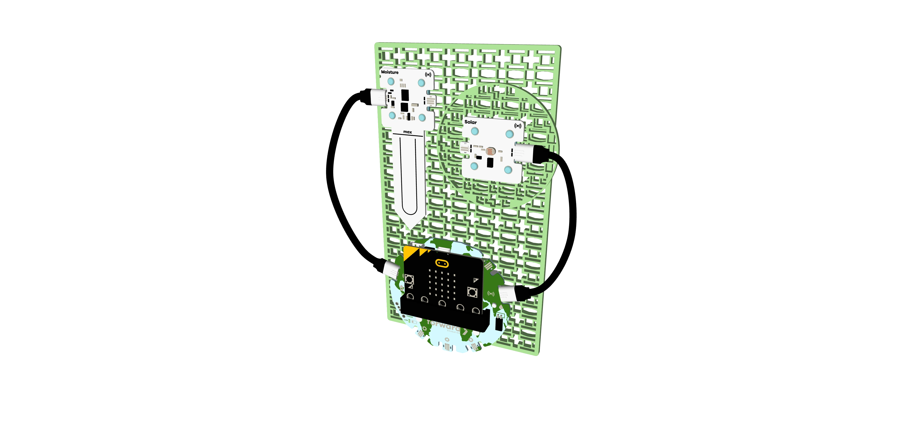
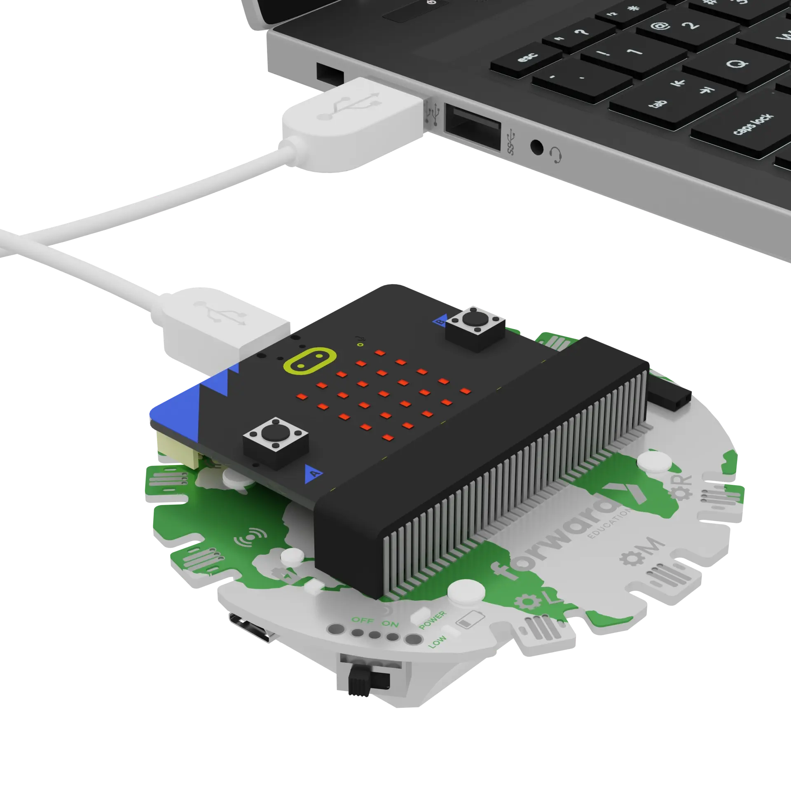
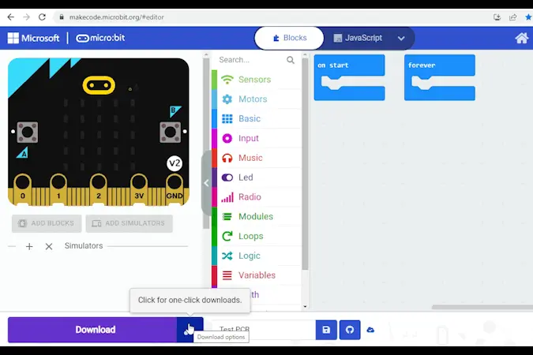

# Habitat Monitoring

```package
fwd-climate-action=github:Forward-Education/pxt-climate-action#v2.1.1
```

```template
input.onButtonPressed(Button.A, function () {
    isReading = true
    basic.showLeds(`
        . . # . .
        . # # # .
        # # # # #
        # # # # #
        . # # # .
        `)
    basic.clearScreen()
    basic.showNumber(Math.round(fwdSensors.moisture1.moistureLevel()))
    basic.clearScreen()
    basic.showString("%")
    basic.pause(1000)
    isReading = false
})
input.onButtonPressed(Button.B, function () {
    isReading = true
    basic.showLeds(`
        # . # . #
        . # # # .
        # # # # #
        . # # # .
        # . # . #
        `)
    basic.clearScreen()
    basic.showNumber(Math.round(fwdSensors.solar1.lightLevel()))
    basic.clearScreen()
    basic.showString("%")
    basic.pause(1000)
    isReading = false
})
let isReading = false
basic.forever(function () {
    for (let x = 0; x <= 4; x++) {
        if (!(isReading)) {
            basic.clearScreen()
            led.plot(x, 2)
        }
        basic.pause(100)
    }
})
```

## Welcome! @showdialog

Ecologists study **habitats**: the places where plants and animals live. They measure things like soil moisture, sunlight, and temperature over time to see how a habitat is changing.

Today you will use a **habitat monitoring device** to collect data, just like an ecologist in the field.

Build your device before you start.



## Three Parts @showdialog

This tutorial has three parts:

1. **Use:** Your code is ready. Collect your first readings.
2. **Modify:** Add a temperature reading, then take your device on a field trip.
3. **Create:** Invent something new on your own.

You can stop after any part. Your work is saved.

## Get Ready @showdialog

Turn on your Breakout Board. Plug your micro:bit into your computer.



## Pair Your micro:bit @showdialog

Click the three dots beside the `|Download|` button. Click **Connect Device**. Follow the steps to pair your micro:bit.



## Download

Click `|Download|` to send the starter code to your micro:bit.

## Part 1: Use @showdialog

Your device's code is already in the workspace. Let's find out how it works.

1. Follow the instructions at the top of the screen.
2. Click **Tell me more!** for more information.
3. Click the lightbulb for help with the code.

## Use Step 1

Look at the micro:bit screen. A dot moves across the middle, over and over.

This shows the device is on and **ready** to take a reading.

```blocks
let isReading = false
basic.forever(function () {
    for (let x = 0; x <= 4; x++) {
        if (!(isReading)) {
            basic.clearScreen()
            led.plot(x, 2)
        }
        basic.pause(100)
    }
})
```

## Use Step 2

What do you think will happen when you press **A**?

Press **A** to check.

~hint Tell me more!
1. Pressing **A** is an **input**. It tells the micro:bit to start.
2. The micro:bit shows a **water drop** icon for soil moisture.
3. It shows the reading from ``||fwdSensors:moisture1 moisture level (%)||``, rounded to a whole number.
4. It shows **%**, then waits 1 second.
5. Then the moving dot comes back.
hint~

```blocks
input.onButtonPressed(Button.A, function () {
    isReading = true
    basic.showLeds(`
        . . # . .
        . # # # .
        # # # # #
        # # # # #
        . # # # .
        `)
    basic.clearScreen()
    basic.showNumber(Math.round(fwdSensors.moisture1.moistureLevel()))
    basic.clearScreen()
    basic.showString("%")
    basic.pause(1000)
    isReading = false
})
```

## Use Step 3

Gently hold the moisture sensor in your hand. With your other hand, press **A** again.

What happened to the reading?

~hint Tell me more!
- The moisture sensor measured the moisture on your skin!
- The drier your hand, the lower the reading.
hint~

## Use Step 4

What do you think will happen when you press **B**? Press **B** to check.

~hint Tell me more!
- **B** works the same way as **A**, but it shows a **sun** icon and the reading from ``||fwdSensors:solar1 light level (%)||``.
- The brighter it is, the higher the reading.
hint~

```blocks
input.onButtonPressed(Button.B, function () {
    isReading = true
    basic.showLeds(`
        # . # . #
        . # # # .
        # # # # #
        . # # # .
        # . # . #
        `)
    basic.clearScreen()
    basic.showNumber(Math.round(fwdSensors.solar1.lightLevel()))
    basic.clearScreen()
    basic.showString("%")
    basic.pause(1000)
    isReading = false
})
```

## Use Step 5

Shine a flashlight on the solar sensor and press **B**. Then cover the sensor with your hand and press **B** again.

How did the readings change?

## Use Step 6

Look at the ``||variables:isReading||`` variable. Each button sets it to **true** at the start and **false** at the end.

Why do you think the code needs it?

~hint Tell me more!
- While ``||variables:isReading||`` is true, the moving dot pauses.
- That way, the dot doesn't draw over the reading, and you can see the number clearly.
hint~

## Checkpoint: You Did It! @showdialog

Your habitat monitoring device measures moisture and light!

**Think:** Why would ecologists want to measure the same habitat many times?

You can stop here. Or click **Next** to go on to **Part 2: Modify**.

## Part 2: Modify @showdialog

Your device measures moisture and light. Let's add a third measurement: **temperature**.

After each change, click `|Download|` and test your device.

## Modify Step 1

Open ``||input:Input||``. Drag ``||input:on button A pressed||`` into the workspace. Change **A** to **A+B**.

~hint Tell me more!
- Now the micro:bit will do something when you press **A and B at the same time**.
- The block is empty for now. We'll fill it in next.
hint~

```blocks
// @highlight
input.onButtonPressed(Button.AB, function () {

})
```

## Modify Step 2

Just like the other buttons, this one should pause the moving dot while it shows a reading.

Open ``||variables:Variables||``. Put ``||variables:set isReading to||`` **true** at the top of the new block.

```blocks
input.onButtonPressed(Button.AB, function () {
    // @highlight
    isReading = true
})
```

## Modify Step 3

Ecologists need to know which reading they're looking at. Let's design a **temperature** icon.

Open ``||basic:Basic||``. Add a ``||basic:show leds||`` block. Click the squares to draw a symbol for temperature, like a thermometer.

~hint Tell me more!
- Get creative! Any symbol works, as long as you'll recognise it in the field.
hint~

```blocks
input.onButtonPressed(Button.AB, function () {
    isReading = true
    // @highlight
    basic.showLeds(`
        . # # # .
        . # . # .
        . # . # .
        . # # # .
        . # # # .
        `)
})
```

## Modify Step 4

Now show the temperature as a whole number.

1. Add ``||basic:clear screen||``.
2. Add ``||basic:show number||``.
3. From ``||math:Math||``, put ``||math:round||`` inside ``||basic:show number||``.
4. From ``||input:Input||``, put ``||input:temperature (°C)||`` inside ``||math:round||``.

~hint Tell me more!
- ``||math:round||`` turns the reading into a whole number. That keeps your data **consistent** with the other two sensors.
hint~

```blocks
input.onButtonPressed(Button.AB, function () {
    isReading = true
    basic.showLeds(`
        . # # # .
        . # . # .
        . # . # .
        . # # # .
        . # # # .
        `)
    // @highlight
    basic.clearScreen()
    // @highlight
    basic.showNumber(Math.round(input.temperature()))
})
```

## Modify Step 5

Let's show the unit, so everyone knows the temperature is in degrees **Celsius**.

1. Add ``||basic:clear screen||``.
2. Add ``||basic:show string||`` and type **C**.
3. Add ``||basic:pause (ms)||`` and set it to **1000**.
4. Finally, add ``||variables:set isReading to||`` **false**, so the moving dot comes back.

```blocks
input.onButtonPressed(Button.AB, function () {
    isReading = true
    basic.showLeds(`
        . # # # .
        . # . # .
        . # . # .
        . # # # .
        . # # # .
        `)
    basic.clearScreen()
    basic.showNumber(Math.round(input.temperature()))
    // @highlight
    basic.clearScreen()
    // @highlight
    basic.showString("C")
    // @highlight
    basic.pause(1000)
    // @highlight
    isReading = false
})
```

## Modify Step 6

Download your code and press **A** and **B** together. Does your device show the temperature?

~hint Tell me more!
- The micro:bit measures temperature with a sensor inside its own processor.
- It often reads a few degrees **warmer** than the air, because the processor warms up as it works.
hint~

## Field Trip! @showdialog

Your device now measures **moisture**, **light**, and **temperature**. It's time to think like an ecologist and take it into the field!

Bring a pen and paper to record your data.

## Field Trip Step 1

Choose one habitat, like a garden, a field, or a patch of trees.

Take a reading with **all three sensors** every 5 minutes, until you have at least **5 readings** of each. Record them in a table.

~hint Tell me more!
Also write down other observations, like:

1. The time of each reading
2. Where you collected your data
3. What the weather was like
4. Which plants and animals you saw
hint~

## Field Trip Step 2

Look at your table. Did any readings change over time? What might have caused those changes?

## Checkpoint: Great Work! @showdialog

You collected real habitat data, just like an ecologist!

**Think:** What trends did you notice in your data?

You can stop here. Or click **Next** to go on to **Part 3: Create**.

## Part 3: Create @showdialog

Now it's your turn to invent!

**Challenge:** How could your device help ecologists even more? Add your own idea to the code.

There are no steps this time. Test your ideas, change them, and test again. Click the lightbulb if you need ideas.

## Create

Add your own idea to your device. Download and test it.

~hint Need ideas?
- **Dry soil alert:** show a warning icon or play a sound when soil moisture is very low.
- **One-button report:** press the micro:bit logo to show all three readings, one after another.
- **Automatic data collection:** add the **Data Logger** extension to save a reading every 5 minutes, so you don't have to write it down.
- **Compare habitats:** collect data in two different places and compare them.
hint~

## Reflection @showdialog

Think about your project:

- How could the code of your device be improved?
- What other sensors might help you learn about a habitat?
- How does monitoring a habitat over time help us understand an ecosystem?

## Finished! @showdialog

Great work! Click `|Done|` to finish the tutorial.
