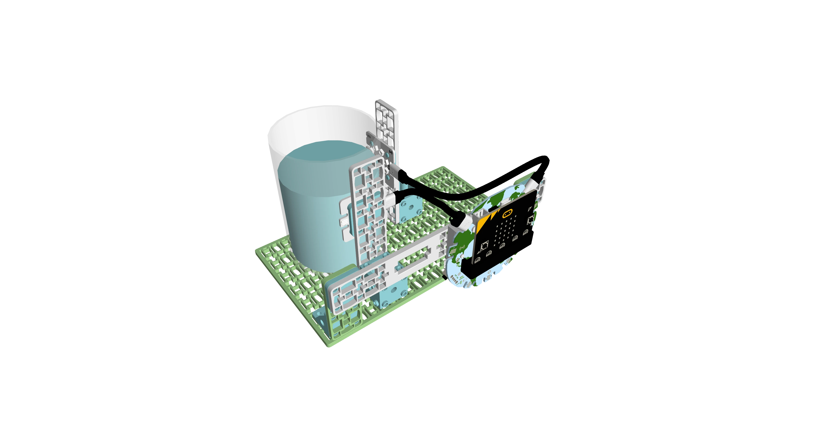
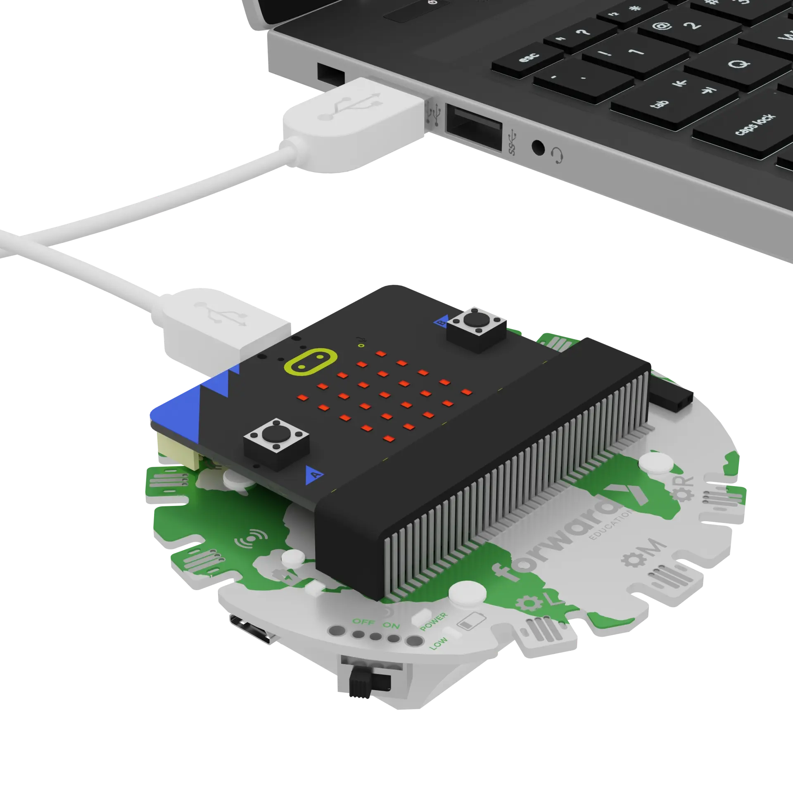
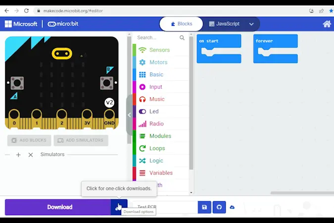
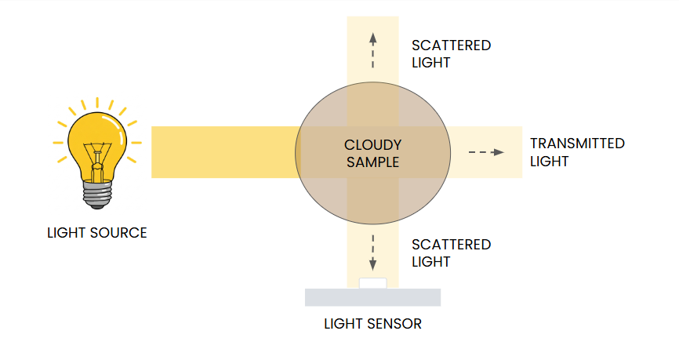
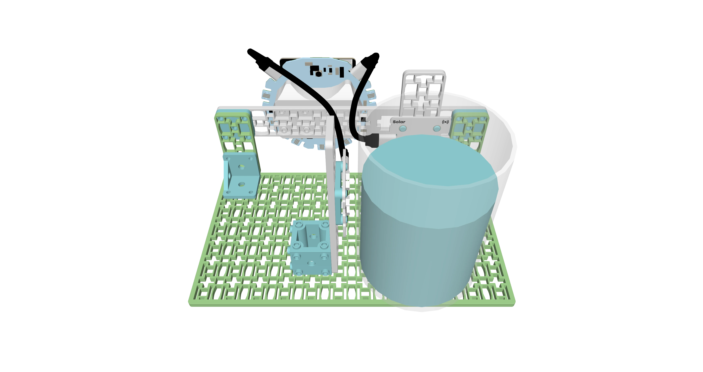
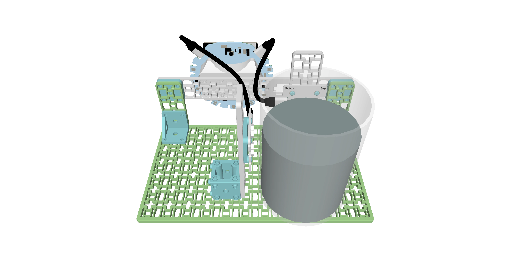

# Turbidity Meters

```package
fwd-climate-action=github:Forward-Education/pxt-climate-action#v2.1.1
```

```template
input.onButtonPressed(Button.A, function () {
    basic.showNumber(fwdSensors.solar1.lightLevel())
})
fwdLights.ledRing1.setBrightness(10)
fwdLights.ledRing1.setAllPixelsColor(0xffffff)
```

## Welcome! @showdialog

**Turbidity** tells us how cloudy water is. Cloudy water is full of tiny particles, like soil, algae, or pollution. Scientists measure turbidity to check if rivers and lakes are healthy, and if water is safe to drink.

Today you will use a model **turbidity meter** to compare water samples.

Build your turbidity meter before you start. You will also need two water samples in clear cups:

1. **Tap water** (low turbidity)
2. **Tap water with 15 mL (1 tablespoon) of baking soda** stirred in (high turbidity)



## Three Parts @showdialog

This tutorial has three parts:

1. **Use:** Your code is ready. Measure your water samples.
2. **Modify:** Change the code so your meter tells you if water is clear or cloudy.
3. **Create:** Invent something new on your own.

You can stop after any part. Your work is saved.

## Get Ready @showdialog

Turn on your Breakout Board. Plug your micro:bit into your computer.



## Pair Your micro:bit @showdialog

Click the three dots beside the `|Download|` button. Click **Connect Device**. Follow the steps to pair your micro:bit.



## Download

Click `|Download|` to send the starter code to your micro:bit.

## Part 1: Use @showdialog

Your turbidity meter code is already in the workspace. Let's find out how it works.

1. Follow the instructions at the top of the screen.
2. Click **Tell me more!** for more information.
3. Click the lightbulb for help with the code.

## Use Step 1

Look at your turbidity meter. Can you find the **light source** and the **light sensor**?

~hint Tell me more!
- The **LED ring** is the light source. It shines light through the water sample.
- The **solar sensor** is the light sensor.
- The solar sensor sits at a **right angle** (90°) to the LED ring. It only catches light that **bounces off** particles in the water.
- The more particles in the water, the more light scatters toward the sensor.
hint~



## Use Step 2

Look at the code in the workspace. What do you think it will do?

~hint Tell me more!
- The two ``||fwdLights:Lights||`` blocks in ``||basic:on start||`` turn the LED ring on, bright white.
- When you press **A**, the micro:bit shows the solar sensor's reading. That's your **turbidity reading**.
hint~

```blocks
fwdLights.ledRing1.setBrightness(10)
fwdLights.ledRing1.setAllPixelsColor(0xffffff)
input.onButtonPressed(Button.A, function () {
    basic.showNumber(fwdSensors.solar1.lightLevel())
})
```

## Use Step 3

Place the **tap water** sample between the LED ring and the solar sensor, as shown below. Make sure the cup is steady and won't spill.



## Use Step 4

Press **A**. What is the reading for tap water? Write it down.

## Use Step 5

Now place the **baking soda** sample in the meter, as shown below.

How do you predict its reading will be different? Why?



## Use Step 6

Press **A**. Write down the reading. Was your prediction right?

## Use Step 7

Compare your two readings:

1. Which sample had the higher turbidity reading?
2. What does that tell you about how clear each sample is?
3. What does it tell you about how many particles are in each sample?

~hint Tell me more!
- The cloudy sample should have a **higher** reading. More particles scatter more light toward the sensor.
- Your meter measures light level in **%**. Real turbidity meters report turbidity in **NTU** (Nephelometric Turbidity Units). They work the same way, but are calibrated against standard samples.
hint~

## Checkpoint: You Did It! @showdialog

Your turbidity meter can tell clear water from cloudy water!

**Think:** Why is it important to test more than one water sample?

You can stop here. Or click **Next** to go on to **Part 2: Modify**.

## Part 2: Modify @showdialog

Now you will change the code so your meter tells you if water is **clear** or **turbid**.

After each change, click `|Download|` and test your meter.

## Modify Step 1

Put the **tap water** back in the meter. Press **A** several times and write down each reading.

Then calculate the **average**: add the readings together and divide by how many there are.

~hint Tell me more!
- Readings change a little each time. Scientists take several readings and average them to get a more reliable result.
hint~

## Modify Step 2

The readings have lots of decimal places, which makes them hard to read. Let's round them to whole numbers.

Open ``||math:Math||``. Drag ``||math:round||`` onto the ``||fwdSensors:solar1 light level (%)||`` block, so it wraps around it.

```blocks
input.onButtonPressed(Button.A, function () {
    // @highlight
    basic.showNumber(Math.round(fwdSensors.solar1.lightLevel()))
})
```

## Modify Step 3

A number on its own doesn't tell us if water is clear or turbid. Let's make the meter decide for us!

We'll use your tap water average as the **clear** baseline. If a reading is at or below it, the water is **CLEAR**. If it's higher, the water is **TURBID**.

~hint Tell me more!
- We'll use a **conditional statement**. It lets the program make a decision.
- The code inside only runs when the condition is true.
hint~

## Modify Step 4

Open ``||logic:Logic||``. Drag an ``||logic:if then||`` block into ``||input:on button A pressed||``, under ``||basic:show number||``.

```blocks
input.onButtonPressed(Button.A, function () {
    basic.showNumber(Math.round(fwdSensors.solar1.lightLevel()))
    // @highlight
    if (true) {

    }
})
```

## Modify Step 5

Drag a ``||logic:0 < 0||`` comparison block into the **if** slot. Change **<** to **≤** (less than or equal to).

```blocks
input.onButtonPressed(Button.A, function () {
    basic.showNumber(Math.round(fwdSensors.solar1.lightLevel()))
    // @highlight
    if (0 <= 0) {

    }
})
```

## Modify Step 6

Put a ``||fwdSensors:solar1 light level (%)||`` block in the first slot. In the second slot, type your **tap water average** from Modify Step 1.

~hint Tell me more!
- The example uses **70**. Use your own average!
- Tap water readings can be a little higher than average sometimes. Adding a few points, like average **+ 5**, stops tap water being called turbid by mistake.
hint~

```blocks
input.onButtonPressed(Button.A, function () {
    basic.showNumber(Math.round(fwdSensors.solar1.lightLevel()))
    // @highlight
    if (fwdSensors.solar1.lightLevel() <= 70) {

    }
})
```

## Modify Step 7

Open ``||basic:Basic||``. Put a ``||basic:show string||`` block inside the **if**. Change "Hello!" to **CLEAR**.

```blocks
input.onButtonPressed(Button.A, function () {
    basic.showNumber(Math.round(fwdSensors.solar1.lightLevel()))
    if (fwdSensors.solar1.lightLevel() <= 70) {
        // @highlight
        basic.showString("CLEAR")
    }
})
```

## Modify Step 8

Click the **+** at the bottom of the **if** block to add an **else**. Put another ``||basic:show string||`` inside it that says **TURBID**.

```blocks
input.onButtonPressed(Button.A, function () {
    basic.showNumber(Math.round(fwdSensors.solar1.lightLevel()))
    if (fwdSensors.solar1.lightLevel() <= 70) {
        basic.showString("CLEAR")
    } else {
        // @highlight
        basic.showString("TURBID")
    }
})
```

## Modify Step 9

Let's add an alarm for turbid water. Open ``||music:Music||``. Put a ``||music:play tone||`` block under **TURBID**.

Test both samples. Does the meter say CLEAR for tap water and TURBID for the cloudy sample?

```blocks
input.onButtonPressed(Button.A, function () {
    basic.showNumber(Math.round(fwdSensors.solar1.lightLevel()))
    if (fwdSensors.solar1.lightLevel() <= 70) {
        basic.showString("CLEAR")
    } else {
        basic.showString("TURBID")
        // @highlight
        music.play(music.tonePlayable(262, music.beat(BeatFraction.Whole)), music.PlaybackMode.UntilDone)
    }
})
```

## Checkpoint: Great Work! @showdialog

Your turbidity meter now classifies water and sounds an alarm!

**Think:** If you found a high turbidity reading in a local river, what might be causing it?

You can stop here. Or click **Next** to go on to **Part 3: Create**.

## Part 3: Create @showdialog

Now it's your turn to invent!

**Challenge:** How could your turbidity meter be more useful to a scientist or a water treatment worker? Add your own idea to the code.

There are no steps this time. Test your ideas, change them, and test again. Click the lightbulb if you need ideas.

## Create

Add your own idea to your turbidity meter. Download and test it.

~hint Need ideas?
- **Custom alarm:** use ``||music:Music||`` and ``||loops:Loops||`` blocks to make an alarm melody that's easy to notice.
- **Three levels:** add an **else if** for a middle level, like **MURKY**, between CLEAR and TURBID.
- **Colour code:** change the LED ring colour for each level, like green for clear and red for turbid. (Remember the LED ring is also your light source!)
- **Test more samples:** try muddy water, juice, or milk diluted with water. Rank them from clearest to cloudiest.
hint~

## Reflection @showdialog

Think about your project:

- How does the amount of scattered light relate to turbidity?
- What are some real-world situations where it's important to measure turbidity?
- What is one thing you want to learn more about?

## Finished! @showdialog

Great work! Click `|Done|` to finish the tutorial.
