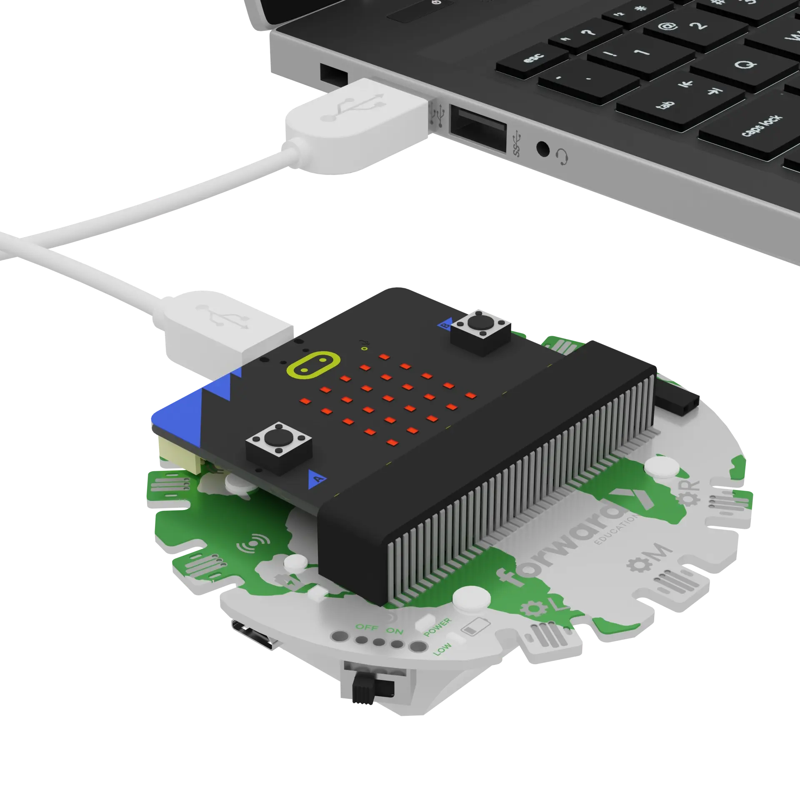
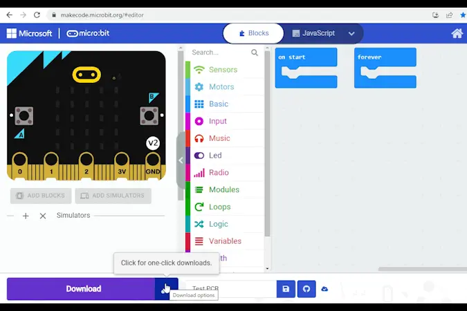

# Wildfire Detection with Autonomous Vehicles

```package
fwd-climate-action=github:Forward-Education/pxt-climate-action#v2.1.1
microphone=microphone
```

```template
input.onButtonPressed(Button.A, function () {
    isDrivingEnabled = true
})
input.onButtonPressed(Button.B, function () {
    isDrivingEnabled = false
})
let isDrivingEnabled = false
fwdMotors.setupDriving(fwdBase.rightServo, fwdBase.leftServo)
basic.forever(function () {
    if (isDrivingEnabled) {
        if (input.lightLevel() > 135) {
            fwdMotors.stop()
            music.playTone(262, music.beat(BeatFraction.Breve))
        } else if (fwdSensors.sonar1.isPastThreshold(0.2, fwdEnums.OverUnder.Under)) {
            fwdMotors.driveTimed(60, 60, 500)
        } else {
            fwdMotors.drive(50, -50)
        }
    } else {
        fwdMotors.stop()
    }
})
```

## Welcome! @showdialog

Wildfires can spread quickly through dry forests. The sooner a fire is spotted, the sooner firefighters can respond.

Today you will code an **autonomous vehicle** that patrols a forest on its own. It steers around trees, and when it finds a fire, it stops and sounds an alarm.

Build your vehicle before you start. You will also need a flashlight, and a few objects like boxes or books to be your "trees."


## Three Parts @showdialog

This tutorial has three parts:

1. **Use:** Your code is ready. Patrol the forest for fires.
2. **Modify:** Make your fire detector more accurate and your alarm easier to notice.
3. **Create:** Invent something new on your own.

You can stop after any part. Your work is saved.

## Get Ready @showdialog

Turn on your Breakout Board. Plug your micro:bit into your computer.



## Pair Your micro:bit @showdialog

Click the three dots beside the `|Download|` button. Click **Connect Device**. Follow the steps to pair your micro:bit.



## Download

Click `|Download|` to send the starter code to your micro:bit.

## Part 1: Use @showdialog

Your vehicle's code is already in the workspace. Let's find out how it works.

1. Follow the instructions at the top of the screen.
2. Click **Tell me more!** for more information.
3. Click the lightbulb for help with the code.

## Use Step 1

Think about what a wildfire detection vehicle needs to do. Can you list **5 tasks** it should be able to complete?

~hint Tell me more!
The vehicle should be able to:

- start driving
- stop (brake)
- patrol a forest without crashing into trees
- detect a fire
- send out an alert
hint~

## Use Step 2

Let's see how the vehicle starts and stops. Unplug your vehicle, put it on the floor, and press **A**. A is like the gas pedal!

After a few seconds, press **B** to stop. B is like the brakes.

## Use Step 3

Look at the code. Can you find the blocks that make **A** work like a gas pedal and **B** work like the brakes?

~hint Tell me more!
- Pressing **A** sets the variable ``||variables:isDrivingEnabled||`` to **true**. Pressing **B** sets it to **false**.
- In ``||basic:forever||``, a **conditional statement** checks the variable. If it's true, the vehicle patrols. If not, it stops.
hint~

```blocks
input.onButtonPressed(Button.A, function () {
    isDrivingEnabled = true
})
input.onButtonPressed(Button.B, function () {
    isDrivingEnabled = false
})
basic.forever(function () {
    // @highlight
    if (isDrivingEnabled) {
        fwdMotors.drive(50, -50)
    } else {
        fwdMotors.stop()
    }
})
```

## Use Step 4

A real forest is full of trees. Our vehicle uses its **sonar sensor** to find them.

Set up a few "trees" (boxes or books) on the floor. Press **A** and watch the vehicle drive toward one. What happens?

~hint Tell me more!
- ``||fwdSensors:sonar1 is under 0.2 m||`` checks if something is closer than 0.2 m (20 cm).
- If something is in the way, the vehicle turns for half a second, then checks again.
- If the path is clear, it keeps driving forward.
hint~

```blocks
basic.forever(function () {
    if (isDrivingEnabled) {
        if (input.lightLevel() > 135) {
            fwdMotors.stop()
            music.playTone(262, music.beat(BeatFraction.Breve))
        } else if (fwdSensors.sonar1.isPastThreshold(0.2, fwdEnums.OverUnder.Under)) {
            fwdMotors.driveTimed(60, 60, 500)
        } else {
            fwdMotors.drive(50, -50)
        }
    } else {
        fwdMotors.stop()
    }
})
```

## Use Step 5

The vehicle also needs to detect fires. Fires are bright, so we use the **micro:bit's light sensor**.

The micro:bit's LED screen can measure how much light is shining on it, from **0** (dark) to **255** (very bright).

## Use Step 6

Which part of the code watches for fire? Make a guess, then check the lightbulb.

~hint Tell me more!
- The first rule checks ``||input:light level||``.
- If it's greater than **135**, the vehicle stops and plays an alarm tone.
- It stays stopped, sounding the alarm, as long as the light is bright.
hint~

```blocks
basic.forever(function () {
    if (isDrivingEnabled) {
        // @highlight
        if (input.lightLevel() > 135) {
            fwdMotors.stop()
            music.playTone(262, music.beat(BeatFraction.Breve))
        } else if (fwdSensors.sonar1.isPastThreshold(0.2, fwdEnums.OverUnder.Under)) {
            fwdMotors.driveTimed(60, 60, 500)
        } else {
            fwdMotors.drive(50, -50)
        }
    } else {
        fwdMotors.stop()
    }
})
```

## Use Step 7

Let's test the fire alarm. Press **A** to start patrolling. Shine the flashlight directly at the micro:bit's LED screen, like the light from a fire.

What does the vehicle do? What happens when you turn off the flashlight?

~hint Tell me more!
- With the flashlight on, the vehicle stops and sounds the alarm.
- When the light goes away, it starts patrolling again.
hint~

## Use Step 8

The code checks for fire **first**, before it checks for trees. Why do you think that order matters?

~hint Tell me more!
- The micro:bit checks each rule in order, and runs the **first** one that's true.
- If a tree and a fire are both nearby, reporting the fire is more important. That's why the fire check comes first!
hint~

## Use Step 9

**Bonus:** Make a forest! Set up several "trees" on the floor. Ask a friend to hide somewhere in the forest with a flashlight as the "fire."

Press **A**. Can your vehicle find its way through the trees and find the fire?

## Checkpoint: You Did It! @showdialog

Your vehicle can patrol a forest on its own and detect a fire!

**Think:** Why might a robot be a better choice than a person for patrolling near a fire?

You can stop here. Or click **Next** to go on to **Part 2: Modify**.

## Part 2: Modify @showdialog

Now you will tune your vehicle and make your fire detector more accurate.

After each change:

1. Plug in your micro:bit and click `|Download|`.
2. Unplug it and test your vehicle.

## Modify Step 1

The number **135** is the **light threshold**: the light level that sets off the alarm.

Change **135** to **1**. Test the vehicle. What happens?

~hint Tell me more!
- A low threshold makes the vehicle **very** sensitive.
- Near a window or a light, it may send **false alarms** just from the normal light in the room.
hint~

```blocks
basic.forever(function () {
    if (isDrivingEnabled) {
        // @highlight
        if (input.lightLevel() > 1) {
            fwdMotors.stop()
            music.playTone(262, music.beat(BeatFraction.Breve))
        } else if (fwdSensors.sonar1.isPastThreshold(0.2, fwdEnums.OverUnder.Under)) {
            fwdMotors.driveTimed(60, 60, 500)
        } else {
            fwdMotors.drive(50, -50)
        }
    } else {
        fwdMotors.stop()
    }
})
```

## Modify Step 2

Now try a threshold of **250**. Shine the flashlight on the micro:bit. What happens now?

~hint Tell me more!
- A high threshold makes the vehicle **less** sensitive. It might miss real fires!
- You may need to hold the flashlight very close, or the alarm may not go off at all.
- The light sensor only goes up to **255**.
hint~

```blocks
basic.forever(function () {
    if (isDrivingEnabled) {
        // @highlight
        if (input.lightLevel() > 250) {
            fwdMotors.stop()
            music.playTone(262, music.beat(BeatFraction.Breve))
        } else if (fwdSensors.sonar1.isPastThreshold(0.2, fwdEnums.OverUnder.Under)) {
            fwdMotors.driveTimed(60, 60, 500)
        } else {
            fwdMotors.drive(50, -50)
        }
    } else {
        fwdMotors.stop()
    }
})
```

## Modify Step 3

A good threshold is high enough to avoid false alarms, but low enough to catch a real fire.

Change it back to **135**, or choose a number that works better in your room.

## Modify Step 4

Does your vehicle bump into trees, or turn away too early?

Change **0.2** in ``||fwdSensors:sonar1 is under 0.2 m||``. Try **0.1** and **0.4**. Which works best in your forest?

~hint Tell me more!
- A bigger number makes the vehicle turn when trees are farther away.
- A smaller number lets it get closer before it turns.
hint~

```blocks
basic.forever(function () {
    if (isDrivingEnabled) {
        if (input.lightLevel() > 135) {
            fwdMotors.stop()
            music.playTone(262, music.beat(BeatFraction.Breve))
        } else if (fwdSensors.sonar1.isPastThreshold(0.4, fwdEnums.OverUnder.Under)) {
            fwdMotors.driveTimed(60, 60, 500)
        } else {
            fwdMotors.drive(50, -50)
        }
    } else {
        fwdMotors.stop()
    }
})
```

## Modify Step 5

Real vehicles are **calibrated**: tested and adjusted until they work just right.

Change **500** in ``||fwdMotors:set left to 60 % and right to 60 % for 500 ms||``. Test until your vehicle turns far enough to get around a tree.

~hint Tell me more!
- A bigger number means a longer turn.
- Every vehicle is a little different, so your number may not match a classmate's.
hint~

```blocks
basic.forever(function () {
    if (isDrivingEnabled) {
        if (input.lightLevel() > 135) {
            fwdMotors.stop()
            music.playTone(262, music.beat(BeatFraction.Breve))
        } else if (fwdSensors.sonar1.isPastThreshold(0.4, fwdEnums.OverUnder.Under)) {
            // @highlight
            fwdMotors.driveTimed(60, 60, 800)
        } else {
            fwdMotors.drive(50, -50)
        }
    } else {
        fwdMotors.stop()
    }
})
```

## Modify Step 6

Light alone can fool our vehicle. What if it drives into a sunny clearing in the forest? It might send an alert even though there's no fire!

Adding **another sensor** can make the alarm more accurate.

## Modify Step 7

The micro:bit has other sensors, like a **microphone**, a **temperature** sensor, and a **compass**.

Which ones would help detect a fire?

~hint Tell me more!
- Fires are bright, loud, and hot!
- The light sensor, the microphone, and the temperature sensor could all help.
- For safety, we'll use **light** and **sound** today. A temperature sensor would be very useful in real life.
hint~

## Modify Step 8

Let's make the alarm respond to loud sounds too.

Right-click the ``||input:light level||`` **> 135** block and choose **Duplicate**. In the copy, replace ``||input:light level||`` with ``||input:sound level||`` from ``||input:Input||``.

~hint Tell me more!
- The new block will look faded for now. That's OK!
hint~

```blocks
basic.forever(function () {
    if (input.soundLevel() > 135) {

    }
})
```

## Modify Step 9

Now let's combine the two checks into one.

Open ``||logic:Logic||``. Drag an ``||logic:or||`` block into the fire **if** slot. Put the **light** check on the left side and the **sound** check on the right.

~hint Tell me more!
- This is a **compound conditional**. It combines two checks in one **if**.
- ``||logic:or||`` is a **Boolean operator**. The alarm goes off if the light is bright **or** the sound is loud.
hint~

```blocks
basic.forever(function () {
    if (isDrivingEnabled) {
        // @highlight
        if (input.lightLevel() > 135 || input.soundLevel() > 135) {
            fwdMotors.stop()
            music.playTone(262, music.beat(BeatFraction.Breve))
        } else if (fwdSensors.sonar1.isPastThreshold(0.4, fwdEnums.OverUnder.Under)) {
            fwdMotors.driveTimed(60, 60, 800)
        } else {
            fwdMotors.drive(50, -50)
        }
    } else {
        fwdMotors.stop()
    }
})
```

## Modify Step 10

Download and test. What happens when you shine the flashlight? What happens when you clap loudly?

## Modify Step 11

Click the drop-down on ``||logic:or||`` and change it to ``||logic:and||``. Test again with the flashlight, then with a clap, then with both at once.

~hint Tell me more!
- ``||logic:and||`` is another **Boolean operator**.
- Now the alarm only goes off when it's bright **and** loud at the same time.
- That means fewer false alarms, and a more accurate fire detector!
hint~

```blocks
basic.forever(function () {
    if (isDrivingEnabled) {
        // @highlight
        if (input.lightLevel() > 135 && input.soundLevel() > 135) {
            fwdMotors.stop()
            music.playTone(262, music.beat(BeatFraction.Breve))
        } else if (fwdSensors.sonar1.isPastThreshold(0.4, fwdEnums.OverUnder.Under)) {
            fwdMotors.driveTimed(60, 60, 800)
        } else {
            fwdMotors.drive(50, -50)
        }
    } else {
        fwdMotors.stop()
    }
})
```

## Challenge Time! @showdialog

Your fire detector is more accurate now. Let's make the alert easier to notice!

**Challenge:** Make a siren that switches between two notes, like an emergency vehicle.

## Challenge Step 1

Drag these blocks into the workspace:

- one ``||loops:repeat 4 times||`` loop
- two ``||music:play tone||`` blocks
- two ``||basic:pause (ms)||`` blocks

How could you put them together to make a two-tone siren? Replace the original ``||music:play tone||`` block with your siren. Then check the lightbulb.

~hint Tell me more!
1. Change the note in one ``||music:play tone||`` block, so the siren switches between two notes.
2. Put a ``||basic:pause (ms) 100||`` after each tone.
3. Wrap the ``||loops:repeat||`` loop around all four blocks, so the siren plays 4 times.
4. Remove the original ``||music:play tone||`` block, and put your siren in its place.
hint~

```blocks
basic.forever(function () {
    if (isDrivingEnabled) {
        if (input.lightLevel() > 135 && input.soundLevel() > 135) {
            fwdMotors.stop()
            // @highlight
            for (let index = 0; index < 4; index++) {
                music.playTone(262, music.beat(BeatFraction.Double))
                basic.pause(100)
                music.playTone(523, music.beat(BeatFraction.Double))
                basic.pause(100)
            }
        } else if (fwdSensors.sonar1.isPastThreshold(0.4, fwdEnums.OverUnder.Under)) {
            fwdMotors.driveTimed(60, 60, 800)
        } else {
            fwdMotors.drive(50, -50)
        }
    } else {
        fwdMotors.stop()
    }
})
```

## Challenge Step 2

Download and test your siren. Did you build it differently from the lightbulb? That's great! There are many ways to make a siren.

## Checkpoint: Great Work! @showdialog

Your vehicle now patrols on its own, has a more accurate fire detector, and sounds an emergency siren!

**Think:** Why is it important for a fire alarm to avoid false alarms?

You can stop here. Or click **Next** to go on to **Part 3: Create**.

## Part 3: Create @showdialog

Now it's your turn to invent!

**Challenge:** How could your vehicle help firefighters even more? Add your own idea to the code.

There are no steps this time. Test your ideas, change them, and test again. Click the lightbulb if you need ideas.

## Create

Add your own idea to your vehicle. Download and test it.

~hint Need ideas?
- **Show a warning:** display a fire icon on the micro:bit while the alarm sounds.
- **Count fires:** keep track of how many fires the vehicle detects, and show the total when you press **A+B**.
- **Back away safely:** after the alarm, make the vehicle back up and turn away from the fire.
- **Smarter patrol:** turn left or right at random when a tree is in the way, so the vehicle explores more of the forest.
hint~

## Reflection @showdialog

Think about your project:

- What was one challenge? How did you solve it?
- How did that make you feel?
- What is one thing you want to learn more about?

## Finished! @showdialog

Great work! Click `|Done|` to finish the tutorial.
